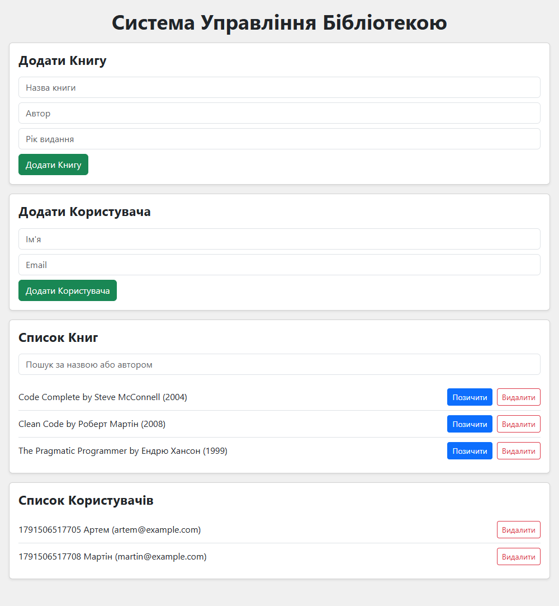
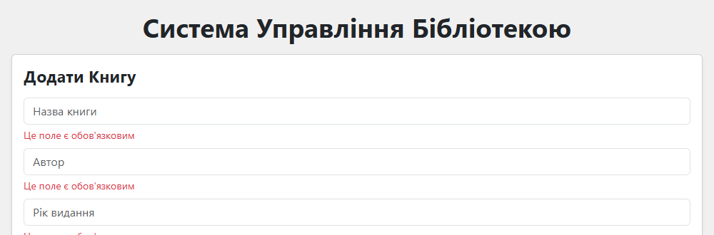
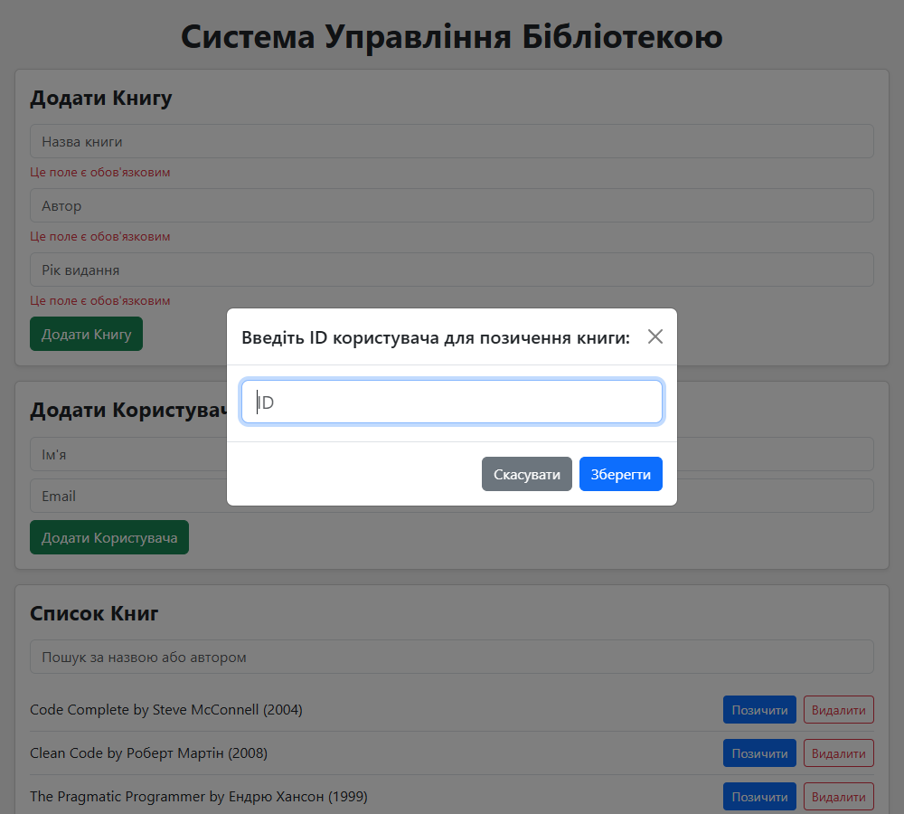

# Library Management

Клієнтський застосунок для керування бібліотекою (лабораторна робота №2, «Інженерія клієнтських веб-систем»).
Книги й користувачі, позичання та повернення, пошук, видалення, пагінація, збереження в LocalStorage.

Увесь інтерфейс будується з коду (TypeScript + DOM API): `index.html` містить лише порожній `<div id="app"></div>`.



|                                         |                                           |
| --------------------------------------- | ----------------------------------------- |
|  |  |
| Помилки валідації під полями            | Запит ID користувача для позичання        |

## Запуск

```bash
npm install
npm start          # dev-сервер: http://localhost:9000
npm run build      # продакшн-збірка в dist/
npm test           # Mocha + Chai
npm run lint       # ESLint (0 попереджень)
npm run typecheck  # tsc --noEmit
npm run format     # Prettier
```

Ця гілка (`main`) збирається **webpack**. Версія на **Vite** лежить у гілці `vite-migration`.

## Вимоги завдання і де вони реалізовані

| Вимога                                              | Де реалізовано                                                                     |
| --------------------------------------------------- | ---------------------------------------------------------------------------------- |
| Лише JS/TS, порожній `div#app` в `index.html`       | `public/index.html`, DOM будується функцією `h()` у `src/ui/dom.ts`                |
| Строга типізація                                    | `tsconfig.json` (`strict`, `noUncheckedIndexedAccess`), типи в `src/types/`        |
| Класи й інтерфейси книг                             | `src/models/Book.ts` (`IBook`, `Book`)                                             |
| Класи й інтерфейси користувачів                     | `src/models/User.ts` (`IUser`, `User`)                                             |
| Generic `Library<T>`: додавання, видалення, пошук   | `src/services/Library.ts`                                                          |
| Клас `Storage` для LocalStorage                     | `src/services/Storage.ts` (`save`, `load`, `remove`, `clear`)                      |
| Модулі й namespace                                  | шари `models`, `services`, `utils`, `ui`; `Validation` у `src/utils/validators.ts` |
| Позичання й повернення змінюють стан книги          | `LibraryService.borrowBook` / `returnBook`, поле `borrowedBy`                      |
| Валідація: обов'язкові поля, ID цифри, рік за regex | `Validation` (`validateBook`, `validateUser`, `validateUserId`, `isValidYear`)     |
| Сповіщення без `alert`                              | `src/ui/Modal.ts` (`NotificationService`, модальні вікна Bootstrap)                |
| Ліміт 3 книги на користувача + модальне вікно       | `MAX_BORROWED_BOOKS` у `LibraryService`, повідомлення в `src/ui/App.ts`            |
| Збереження в LocalStorage між перезавантаженнями    | `LibraryService.persist()` / `restore()`                                           |
| ESLint і Prettier, 0 попереджень                    | `eslint.config.mjs`, `.prettierrc`, `npm run lint`                                 |
| Mocha + Chai: `Library`, `Validation`               | `tests/library.test.ts`, `tests/validation.test.ts` (+ ще три набори)              |
| Husky pre-commit                                    | `.husky/pre-commit`: `npm run lint` і `npm test`                                   |
| Пошук за автором або назвою                         | `LibraryService.searchBooks`, поле пошуку в `src/ui/App.ts`                        |
| Видалення книг і користувачів                       | кнопки «Видалити» в `src/ui/lists.ts`                                              |
| Пагінація по 5                                      | `src/utils/pagination.ts`, `src/ui/Pagination.ts`                                  |
| Webpack і окрема гілка Vite                         | `webpack.config.js` (main), `vite.config.ts` (`vite-migration`)                    |
| Деплой на GitHub Pages                              | `npm run deploy` (gh-pages)                                                        |
| Порівняння webpack і Vite                           | розділ нижче                                                                       |

## Можливості

- Додавання книг (назва, автор, рік) і користувачів (ім'я, email) з валідацією.
- Позичання книги за ID користувача (лише цифри). Ліміт: **3 книги на користувача**, при спробі взяти четверту з'являється модальне вікно.
- Повернення книги. Сповіщення про позичання й повернення виводяться модальними вікнами Bootstrap (без `alert`).
- Пошук за назвою або автором, видалення книг і користувачів, пагінація по 5 елементів.
- Дані зберігаються в LocalStorage і переживають перезавантаження сторінки.

### Правила валідації

- Усі поля обов'язкові; назва, автор і ім'я мають містити щонайменше 2 символи.
- Рік: чотири цифри за регулярним виразом `^(1[5-9]\d{2}|20\d{2})$` (1500–2099) і не з майбутнього.
- ID користувача в модальному вікні: лише цифри, користувач має існувати.
- Email: формат адреси, унікальний серед користувачів (без урахування регістру).

## Структура

```
src/
  types/       спільні типи й інтерфейси (Id, Identifiable, BookData, UserData)
  models/      Book, User: лише дані та інтерфейси, без UI і сховища
  services/    Library<T> (generic), LibraryService (позичання/повернення/ліміт), Storage
  utils/       validators.ts (namespace Validation), pagination.ts, id.ts
  ui/          єдиний шар, що працює з DOM: форми, списки, модальні вікна, App
  styles/      main.css
tests/         Mocha + Chai (окремо від src/)
docs/          скріншоти
public/        index.html (з порожнім #app)
.husky/        pre-commit хук
.github/       CI (lint, typecheck, тести, збірка)
```

Залежності йдуть в один бік: `ui` → `services` → `models`. DOM використовує тільки шар `ui`.

Ключові рішення:

- **Generics:** `Library<T extends Identifiable>` працює і з книгами, і з користувачами; пошук приймає предикат, тож клас не знає про поля `T`.
- **Namespace:** `Validation` групує правила валідації всередині модуля.
- **Storage** працює через інтерфейс `StorageBackend`, тому в тестах підставляється сховище в пам'яті.
- **Результат позичання** це тип-об'єднання `{ ok: true, … } | { ok: false, reason }`, UI вирішує, що показати.
- **Без `innerHTML`:** елементи створюються через `createElement` і `textContent`.

## Якість коду

- **ESLint** (typescript-eslint) + **Prettier**: `npm run lint` проходить із `--max-warnings 0`.
- **Mocha + Chai**: 44 тести для `Library`, `Validation`, `Storage`, `LibraryService`, пагінації та генерації id.
- **Husky**: хук `.husky/pre-commit` запускає `npm run lint` і `npm test`; коміт із помилкою лінтера або тестів блокується.
- **CI** (GitHub Actions): на кожен push і pull request виконуються `lint`, `typecheck`, тести та збірка.
- **Git:** feature-гілки (`feature/*`) зливаються в `main` через `--no-ff`, повідомлення за Conventional Commits.

## Розгортання на GitHub Pages

```bash
npm run deploy     # збірка + публікація dist/ у гілку gh-pages, підпапка /webpack
```

У гілці `vite-migration` та сама команда публікує підпапку `/vite`, тож обидві версії доступні одночасно:
`https://<користувач>.github.io/<репозиторій>/webpack/` і `.../vite/`.

## Порівняння webpack і Vite

Вимірювання на цьому проєкті (Windows 11, Node 24, webpack 5.111 і Vite 8.3, холодний запуск, середнє з 3 запусків):

| Критерій                                       | webpack                                                                              | Vite                                                              |
| ---------------------------------------------- | ------------------------------------------------------------------------------------ | ----------------------------------------------------------------- |
| Старт dev-сервера (до першої відповіді на `/`) | ≈ 5,0 с                                                                              | ≈ 1,7 с                                                           |
| Продакшн-збірка                                | ≈ 6,1 с                                                                              | ≈ 1,4 с                                                           |
| JS у `dist` (без sourcemap)                    | 1150 КБ (CSS вбудовано в JS)                                                         | 94 КБ JS + 230 КБ CSS                                             |
| JS, gzip                                       | ≈ 183 КБ                                                                             | ≈ 28 КБ (+ CSS окремо)                                            |
| Конфігурація                                   | `webpack.config.js` 45 рядків, 7 пакетів (webpack, CLI, dev-server, loaders, plugin) | `vite.config.ts` 13 рядків, 1 пакет (`vite`)                      |
| TypeScript                                     | `ts-loader` + повна перевірка типів під час збірки                                   | транспіляція без перевірки типів, потрібен окремий `tsc --noEmit` |
| Стилі Bootstrap                                | `style-loader` + `css-loader`                                                        | імпорт працює «з коробки»                                         |
| `index.html`                                   | шаблон у `public/`, скрипт підставляє плагін                                         | у корені, скрипт підключається вручну (`<script type="module">`)  |

Примітки до вимірювань:

- Dev-сервер Vite віддає `/` одразу й трансформує модулі на вимогу, а webpack спершу збирає весь бандл, тому порівняння старту не зовсім «яблуко до яблука» й показує, скільки чекає розробник до першої сторінки.
- Різниця в розмірі бандла здебільшого про конфігурацію: у webpack CSS потрапляє в JS через `style-loader` і не мінімізується. Додавши `mini-css-extract-plugin` і `css-minimizer-webpack-plugin`, його можна наблизити до Vite, але це ще пакети й рядки конфігурації.
- Швидкість HMR окремо не вимірювалась: в обох інструментах оновлення модуля в цьому невеликому проєкті відбувається непомітно для людини. Архітектурна різниця (Vite оновлює один модуль через native ESM, webpack перебудовує граф залежностей) проявляється на великих проєктах.

**Висновок для невеликого SPA.** Vite виграє в усьому, що відчуває розробник щодня: швидкий старт, мінімум конфігурації, розумні налаштування за замовчуванням. Webpack залишається виправданим, коли потрібне тонке керування збіркою, рідкісні loaders або вже існує велика збірка, але для проєкту такого масштабу його гнучкість — зайва складність. Втрата Vite: типи не перевіряються під час збірки, тому в CI та pre-commit потрібен окремий `tsc --noEmit`.
